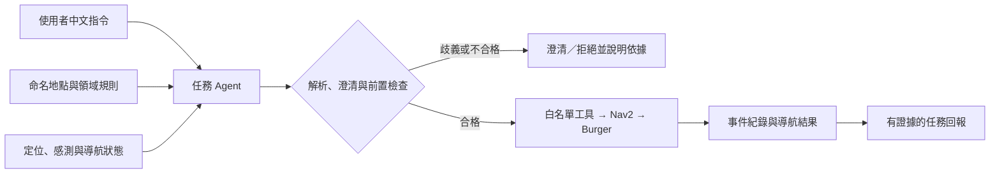

# TurtleBot3 室內導航與任務決策 AI Agent

以 **TurtleBot3 Burger** 為平台，結合大型語言模型（LLM）、ROS 2 與 Nav2，將中文導航指令轉換為可驗證、可追溯的導航任務。

> **專案狀態：研究提案階段，尚無導航實驗結果。** 本儲存庫目前提供提案與分析文件，尚未包含可執行系統、實驗資料或完成驗證的導航程式。以下效益與測試均為規劃。

## 文件導覽

| 文件 | 內容 |
| --- | --- |
| [完整研究提案](docs/TB3_Proposal.pdf) | 問題定義、文獻、領域分析、架構、演算法與評估規劃 |
| [500 字專業摘要](docs/500%20字專業摘要.pdf) | 研究動機、方法與預期成果 |
| [A2Z 解析內容](docs/A2Z-解析內容.pdf) | 提案結構與作業規範的對照分析，作為補充資料 |
| [設計摘要](DESIGN.md) | 模組責任、任務流程、介面與失敗處理 |

原始 PDF 保留上傳內容。主提案內的舊 GitHub 網址為原稿資訊；本次文件整理使用的儲存庫為 [DIC3-Project-Proposal](https://github.com/yuan0307212-ops/DIC3-Project-Proposal)。補充解析與圖像若有文字或頁數差異，以主提案 PDF 為依據。

## 研究目標

中文指令可能包含模糊地點，LLM 也可能產生不存在的目標，或忽略定位與感測資料過期。本專題研究以地點白名單、歧義澄清、前置狀態檢查與事件紀錄，減少不當派送並改善回報的可追溯性。

- **RQ1：** 澄清能否減少歧義造成的不當派送？
- **RQ2：** 狀態檢查能否減少不當執行？
- **RQ3：** 任務回報是否有可核對的執行證據？

研究範圍為單台 Burger、單一平面、預建地圖及人工登錄的命名地點。LLM 負責高層語意理解與任務處理；Nav2 負責路徑規劃、避障與控制。

## 系統架構與流程

八個模組包含使用者、任務輸入、任務 Agent、資料取得、分析引擎、領域知識、決策與工具、輸出與互動。詳細責任與失敗處理見 [DESIGN.md](DESIGN.md)。

## 評估規劃

| 項目 | 規劃 |
| --- | --- |
| 中文指令 | 60 筆：20 筆開發、40 筆鎖定測試；依語意模板分組切分 |
| 指令類型 | 明確地點、歧義、未知地點、取消、複合任務、越權／矛盾輸入，各 10 筆 |
| 模擬情境 | 空曠、窄通道、新增障礙物、狀態異常／目標不可達 |
| 模擬次數 | 每類 2 組起終點、每組重複 5 次，共 40 次／方法 |
| 實機 | 12 個經檢查的配對案例，進行三方法比較 |
| 基準 | B0 固定地點選單；B1 LLM 直接解析＋基本 schema／地點白名單；B2 完整 Agent |
| 消融 | 移除澄清、移除 Agent 前置狀態檢查；先於離線或模擬評估 |

各方法固定相同 Nav2、地圖、參數與底層停止機制。B0 不參與自然語言解析正確率比較；正確拒絕或停止不能算成到達。

評估地點／處理正確率、不當派送率、任務完成率、回報正確率、延遲、路徑與碰撞。比例報告樣本數與 Wilson 95% 信賴區間，延遲報告 p50／p95，模擬與實機分開統計。

## 後續實作與重現

1. 固定 ROS 2、Nav2、Gazebo 及實機配套版本，完成地圖、定位與單點導航基準。
2. 建立命名地點表、任務 schema、白名單工具、狀態檢查與事件記錄。
3. 接入 LLM，固定模型 ID、參數與 prompt hash，完成澄清、取消及失敗處理。
4. 鎖定測試集，執行基準、消融、模擬與實機評估，保留失敗案例。
5. 補上實際安裝指令、啟動流程、版本、設定與可重現實驗資料。

目前未提供可執行程式，因此尚無安裝或啟動命令。預期減少不當派送、提升回報可追溯性，實際效益須待測試驗證。

## 團隊與資料來源

主提案為第 7 組五人專題：陳至恆、蕭丞皓、林瑞裕、邱原美、官奕愷。分工與完整參考文獻請見主提案；研究脈絡包含 ReAct、SayCan、ROS 2 LLM 延遲研究、Nav2、SLAM Toolbox 與 BARN。

本 README 與設計摘要依上傳文件整理。文件提及的交付規劃不代表程式或實驗已完成；未另行指定授權條款。
